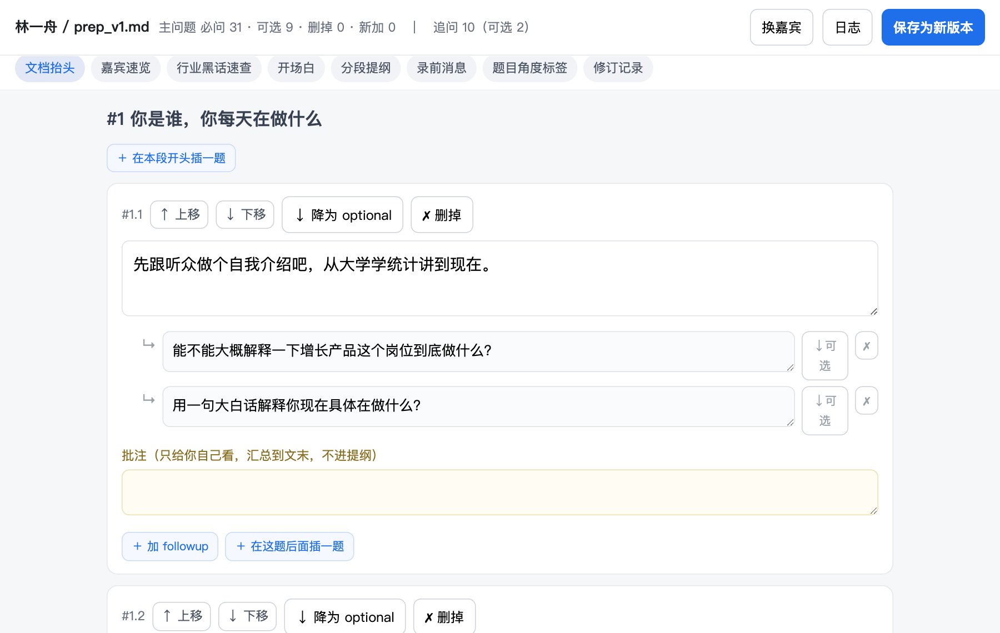

# open-podcast-kit

**An AI toolkit for interview podcasts: do the guest homework and write sharp questions before you record, then QC the final cut before you publish.**

[中文](README.md)

This kit comes out of a real, weekly Chinese-language career-interview video podcast. Every rule in it was earned the hard way: the AI drafted, the host rewrote, and after dozens of rounds every edit the host kept making was turned into a standard.

It runs as a set of [Claude Code](https://claude.com/claude-code) skills. Once installed, you just say "help me prepare for my interview with this guest" and Claude follows the workflow.

> **Language support today:** loudness correction and final-cut QC work on any language. The interview-prep prompts, question bank and card checker are Chinese-first; an English preset is on the roadmap, and contributions are welcome.



## Try it in 30 seconds

No Claude Code needed, just Python 3.9+ (already on a Mac that has git). This uses the fictional guest in the repo (the demo card is in Chinese):

```bash
git clone https://github.com/coachbhuang/open-podcast-kit.git
cd open-podcast-kit
python3 skills/interview-prep/scripts/check_prep_card.py examples/demo-guest/prep_v1.md --config kit.example.toml
python3 skills/interview-prep/scripts/prep_card_serve.py demo-guest --guests examples --config kit.example.toml --open
```

The first command checks the card; the second opens the editor above. With [ffmpeg](https://ffmpeg.org) installed, measure your own episode (works in any language):

```bash
python3 skills/normalize-loudness/scripts/loudness.py measure your-episode.mp4
```

## What's inside

### Before recording: interview prep

| Skill | You say | It does |
|---|---|---|
| `guest-research` | "Research this guest" | Gathers public info and pulls transcripts of the guest's past podcast / video interviews, so you can skip the angles they've been asked to death and dig where no one followed up |
| `interview-prep` | "Write a prep card for X" | A personalised host card: guest brief, jargon cheat sheet, opening-line options, segmented questions and a pre-interview message. It runs automated checks, then exports a question sheet PDF for the guest to tick |
| `guest-outreach` | "Invite X onto the show" | Ready-to-send invitation and follow-up messages, plus a follow-up log that reminds you who to nudge |

What makes the prep card different:

- **Questions with teeth**: each question layers two or three of: a hard number from the résumé, a provocative premise, an emotional probe, the listener's point of view, myth-busting.
- **What the guest sees stays clean**: the PDF only takes the question outline; internal notes (where to push for specifics, which moment could become a short clip) physically can't get in, and the checker blocks any leak.
- **Automated checks**: question-mark count, questions per segment, where the money question sits, third-person slips, jargon count, number of opening options. One command before you hand it in.
- **A pacing template**: 90 minutes in five segments, alternating hard information with emotional beats, with natural bridges between segments.
- **A web editor**: no hand-editing markdown. In the browser you can delete, mark optional, rewrite, annotate, add and reorder questions (across segments too). Every save writes a new version, deleted questions go to an archive at the end so you can bring them back, and the checker runs automatically.

  ```bash
  python3 skills/interview-prep/scripts/prep_card_serve.py --open
  ```

### After editing: final-cut QC

| Skill | You say | It does |
|---|---|---|
| `normalize-loudness` | "This episode is too quiet" | Measures loudness, true peak and noise floor; fixes it with static gain plus a limiter (no pumping), without re-encoding the video; checks spliced sections for sudden level jumps |
| `review-cut` | "QC my final cut" | Checks specs, out-of-order or missing subtitles, loudness and long silences; builds contact sheets on a 30-second grid and at every edit point so Claude can spot black frames, mis-spliced shots and subtitles that don't match the speaker |

## Quick start

You need [Claude Code](https://claude.com/claude-code), Python 3.9+, and [ffmpeg](https://ffmpeg.org) for the audio and QC tools. Playwright is optional, for PDF export.

1. **Install**, in Claude Code:
   ```
   /plugin install open-podcast-kit --marketplace coachbhuang/open-podcast-kit
   ```
   On older Claude Code versions, run `/plugin marketplace add coachbhuang/open-podcast-kit` first, then `/plugin install open-podcast-kit`. Or copy the folders under `skills/` into your podcast folder's `.claude/skills/`.
2. **Describe your show**: copy `kit.example.toml` into your podcast folder as `kit.toml` and fill in show name, host, audience, opening line, guest benefits and content red lines.
3. **Use it**: hand Claude a guest's résumé and ask for a prep card. To see the output first, look at `examples/demo-guest/` (a fictional guest).

## What it runs and connects to

- **Local scripts**: the card checker, editor, loudness and QC tools run on your computer. They have no telemetry and do not upload files on their own.
- **ffmpeg / ffprobe**: read the media you point them at. Loudness correction saves a new `_loudnorm` file by default and leaves the original alone. QC contact sheets are written to a local folder.
- **Web editor**: listens only on `127.0.0.1` and only reads and writes prep-card versions in the guest folder. With `--open`, it opens your default browser.
- **Question sheet PDF**: optional Playwright renders it locally.
- **Claude**: résumés, cards and conversations you give Claude are handled under your Claude account settings.
- **Web research**: when Claude has web tools, `guest-research` searches for the guest's public information. Search terms may include the guest's name and company.
- **Transcript tool**: the third-party tool in Credits is not bundled or installed automatically. If you install and use it, it contacts Xiaoyuzhou, Apple Podcasts, YouTube or the audio URL you provide.

## Privacy

Guest material lives under `guests/` in your own folder (git-ignored). Apart from Claude, web search and any transcript tool you choose, this kit does not send guest material anywhere. Messages are drafts only; you always send them yourself.

## Credits

The transcript tool recommended for guest research, [podcast-transcript-txt-skill](https://github.com/KingJing1/podcast-transcript-txt-skill), is by @一龙小包子 (MIT).

## License

[MIT](LICENSE)
